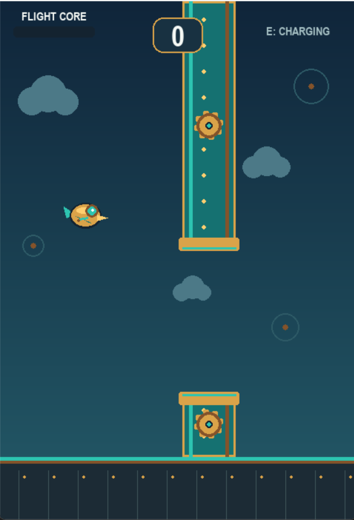

# ⚙️ GEARWING: Flight Protocol ✈️

**Theme: Gear + Flight**

GEARWING: Flight Protocol is a 2D arcade flight game developed using **Python and Pygame**, inspired by the combination of mechanical gears and flight. The player controls a mechanical flying character, navigates through gear-themed obstacles, and uses a special boost ability to survive and achieve a higher score.

## 🎮 Gameplay Screenshot



*GEARWING: Flight Protocol — a mechanical flight arcade game built around the Gear + Flight theme.*

## 🎮 Game Features

- **Gear-Inspired Design:** Mechanical visuals and gear-themed obstacles bring the Gear concept into the gameplay.
- **Flight Mechanics:** Control the flying character and navigate through challenging obstacles.
- **Wind-Up Boost:** Earn energy by passing obstacles and activate a special boost to gain extra upward momentum.
- **Score System:** Earn points by successfully passing obstacles.
- **Best Score Tracking:** Save your best score between game sessions.
- **Arcade Gameplay:** Restart and try again to beat your previous record.

## 🎯 Theme Implementation: Gear + Flight

The game combines the two elements of the assigned theme:

- **Gear:** Mechanical aesthetics, gear-inspired obstacles, and the wind-up energy mechanic represent the engineering and machinery aspect.
- **Flight:** The player navigates the environment using flight controls, avoids obstacles, and uses upward boosts to stay airborne.

Together, these elements create a simple arcade experience that explores the relationship between mechanical power and flight.

## 🕹️ Controls

| Action | Control |
|---|---|
| Fly / Flap | `Space` or Mouse Click |
| Activate Wind-Up Boost | `E` |
| Restart after a crash | `Space` or Mouse Click |
| Quit | `Escape` |

## 🛠️ Technology Stack

- **Language:** Python
- **Library:** Pygame
- **Graphics:** Procedurally drawn shapes and game elements

## ▶️ How to Run

1. Install Python.
2. Clone this repository:

   ```bash
   git clone https://github.com/siddarthcet2007-glitch/Gearwing.git
   cd Gearwing
   ```

3. Install the dependency:

   ```bash
   pip install pygame
   ```

4. Start the game:

   ```bash
   python main.py
   ```

## 🌟 Project Objective

This project was created as a game development submission based on the **Gear + Flight** theme. It focuses on implementing core arcade mechanics, mechanical visual design, collision detection, scoring, and a boost system in a lightweight, playable game.

---

**Built with Python and Pygame | Theme: Gear + Flight**